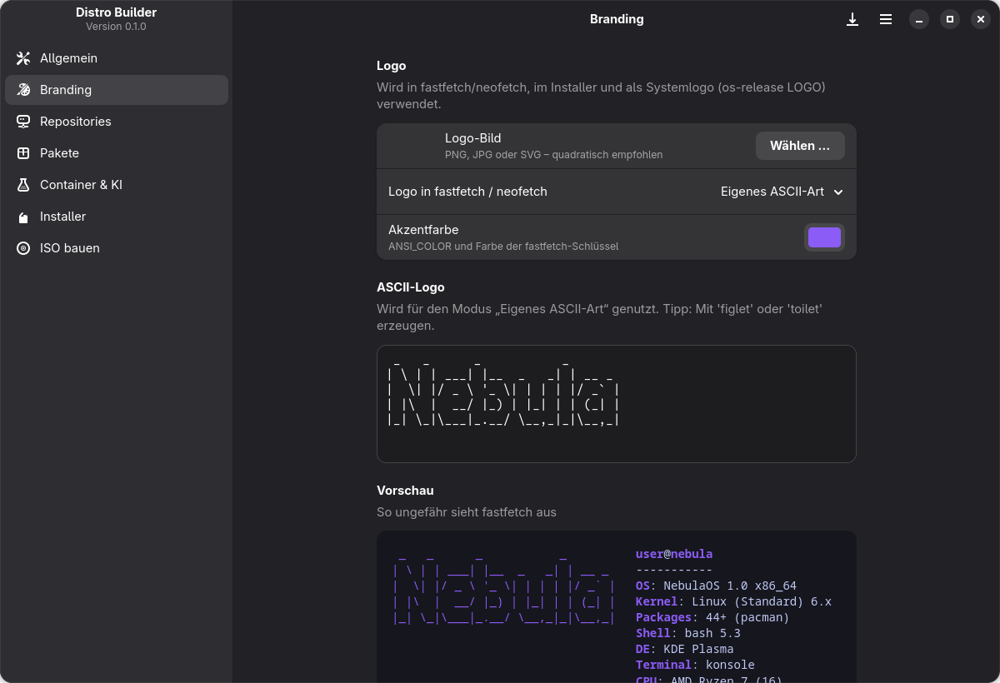
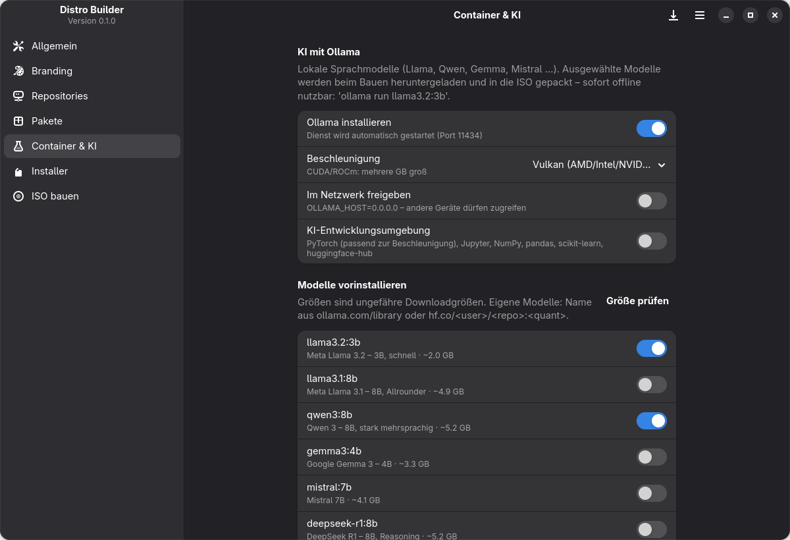
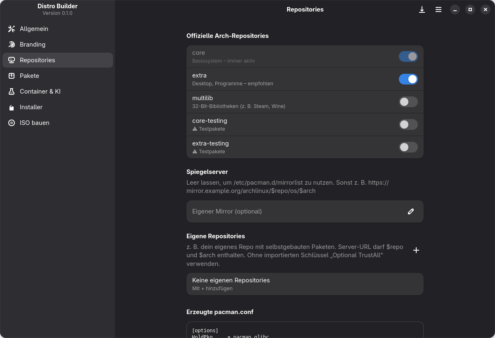
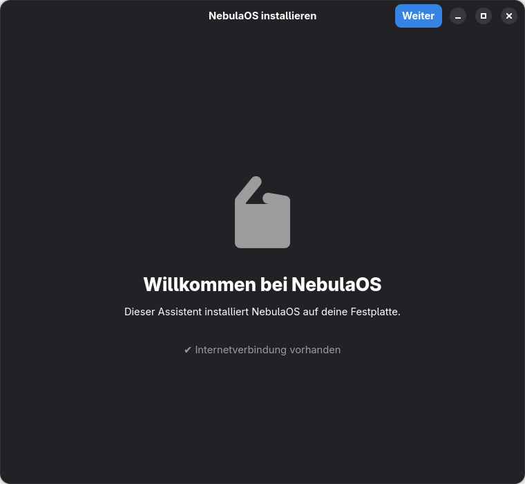
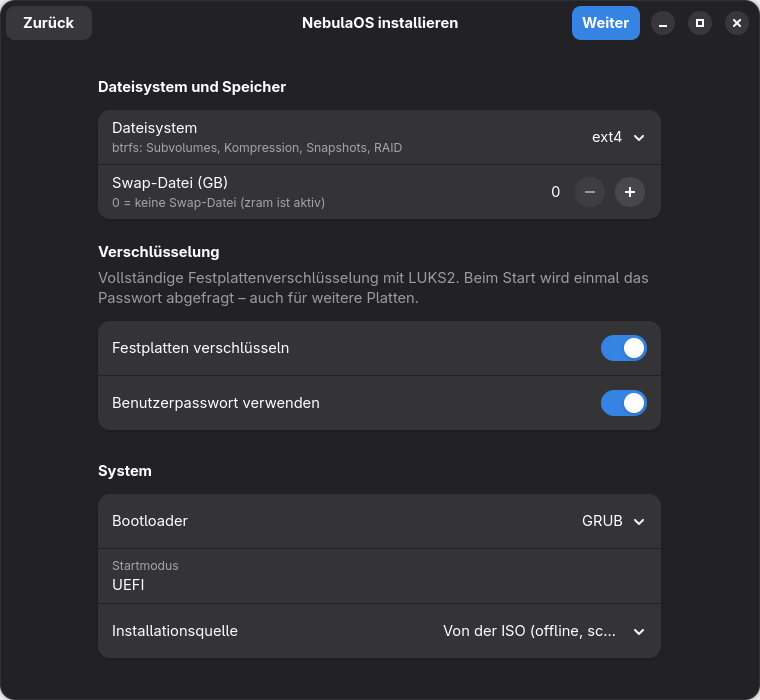

# Distro Builder

Baukasten für deine eigene Linux-Distribution auf Basis von **Arch Linux**. In einer
GTK4/libadwaita-Oberfläche stellst du Name, Logo, Repositories, Pakete, Desktop, KI-Modelle
und Container zusammen. Distro Builder erzeugt daraus eine bootfähige **ISO mit eigenem
grafischen Installer** für PCs oder ein **fertiges Image für ARM64 und den Raspberry Pi**.



- **Branding:** Name, `/etc/os-release`, Logo für fastfetch/neofetch (Bild, Zeichengrafik oder ASCII-Art), Akzentfarbe, Hintergrundbild, Bootmenü, motd
- **Repositories:** core, extra, multilib, testing, eigener Mirror, eigene Repos mit SigLevel und Reihenfolge
- **Pakete:** Kernel (linux, lts, zen, hardened), Desktop (KDE Plasma, GNOME, Xfce, Cinnamon, LXQt), Grafiktreiber (Mesa, AMD, Intel, NVIDIA), Paket-Sammlungen, Paketsuche
- **KI:** Ollama mit CPU, CUDA, ROCm oder Vulkan. Modelle wie Llama, Qwen, Gemma oder Mistral werden **direkt in die ISO gepackt**. Optional PyTorch und Jupyter.
- **Container:** Docker oder Podman, vorgeladene Images, Container-Apps als Compose-Stacks (Open WebUI, Portainer, SearXNG oder eigene)
- **Plattformen:** x86_64 (ISO mit Installer), ARM64 mit UEFI und Raspberry Pi 4/400/5 (fertiges Disk-Image auf Basis von Arch Linux ARM)
- **Flatpak:** Apps aus Flathub oder eigenen Flatpak-Quellen, auf Wunsch direkt mitgeliefert, dazu Discover bzw. GNOME Software
- **Distrobox:** Ubuntu, Fedora, Debian & Co. als Container, die beim ersten Anmelden fertig eingerichtet werden
- **Live-System:** wahlweise **ohne Installer** (Rettungs-, Kiosk- oder Gaming-ISO), eigener Benutzername und Passwort (nur als SHA-512-Hash gespeichert), sudo-Regel, Autologin, `copytoram`
- **Grafischer Installer:** Installation **offline direkt von der ISO**, mehrere Festplatten (`/home`, Datenlaufwerke, btrfs-RAID 1), **LUKS2-Verschlüsselung**, ext4 oder btrfs, GRUB oder systemd-boot
- **Bauen:** ein Klick, Fortschritt und Log, danach die ISO direkt in QEMU testen

> **Projektstatus 0.1.0 – frühe Version.** Profilerzeugung, Oberflächen und Downloads sind
> getestet (siehe [Tests](#entwicklung)). Der komplette Ablauf aus ISO-Build und Installation
> auf echter Hardware ist noch nicht umfassend erprobt. Teste deine ISO zuerst in einer VM.
> Der Installer **löscht die gewählten Festplatten vollständig**.

## Installation

### Arch Linux

```bash
git clone https://github.com/bonbon08/distro-builder.git
cd distro-builder
makepkg -si
```

### Direkt aus dem Quellordner

```bash
sudo pacman -S --needed rust gtk4 libadwaita archiso
cargo build --release --workspace
cargo run --release -p distro-builder
```

Benötigt: Rust/Cargo, GTK ≥ 4.12, libadwaita ≥ 1.5, `archiso`, `polkit` (für `pkexec`).
Bauen lassen sich die ISOs nur auf Arch Linux oder einer Arch-basierten Distribution, weil `mkarchiso` pacman braucht.

Optional:

| Paket | Wofür |
|---|---|
| `skopeo` (oder docker/podman) | Container-Images in die ISO packen |
| `qemu-desktop`, `edk2-ovmf` | Fertige ISO mit „In VM testen“ starten (UEFI) |
| `qemu-user-static`, `qemu-user-static-binfmt` | ARM64-/Raspberry-Pi-Images bauen |
| `flatpak` | Flatpak-Apps beim Bauen mitliefern |

## Schnellstart

1. `distro-builder` starten.
2. **Allgemein:** Namen eingeben und die Zielplattform wählen (x86_64, ARM64 oder Raspberry Pi). Die ID für Dateinamen wird automatisch erzeugt.
3. **Branding:** Logo und Hintergrundbild wählen. Die Vorschau zeigt, wie fastfetch aussieht.
4. **Pakete:** Desktop und Kernel wählen, Sammlungen und eigene Pakete hinzufügen.
5. Optional **Container & KI:** Ollama und Modelle, Docker und Container-Apps.
6. Optional **Flatpak & Distrobox:** Flatpak-Apps und Distrobox-Container.
7. **Bauen** → „ISO bauen“ bzw. „Image bauen“ klicken und das Passwort für `pkexec` eingeben.
8. Das Ergebnis liegt in `~/DistroBuilder/<id>/out/`. Eine ISO startest du mit **In VM testen** direkt in QEMU, ein ARM-Image schreibst du auf SD-Karte oder USB-Stick.

Projekte speicherst du mit Strg+S als JSON. Der letzte Stand wird beim Schließen automatisch gesichert.

## Oberfläche

| Seite | Inhalt |
|---|---|
| **Allgemein** | Name, ID, Version, Hostname, Zielplattform, Herausgeber, URLs |
| **Branding** | Logo, Logo-Modus, Akzentfarbe, ASCII-Logo, Live-Vorschau, Hintergrund, motd, fastfetch beim Terminalstart |
| **Repositories** | Offizielle Repos, Mirror, eigene Repos, Vorschau der erzeugten `pacman.conf` |
| **Pakete** | Kernel, Desktop, Grafiktreiber, Rettungswerkzeuge, Sammlungen, eigene Pakete, Suche, Prüfung |
| **Container & KI** | Ollama, Beschleunigung, Modelle mit Größenprüfung, Entwicklungsumgebung, Docker/Podman, Images, Compose-Stacks |
| **Flatpak & Distrobox** | Flatpak an/aus, Flathub, App-Store, Vorladen, Apps, eigene Quellen, Distrobox-Container |
| **Live & Installer** | Medium (mit Installer oder nur Live-System), Live-Benutzer (Name, Passwort, sudo, Autologin, copytoram), Installer-Autostart, Standardwerte (Quelle, Verschlüsselung, Bootloader, Swap, Sprache, Zeitzone, Tastatur, Dateisystem). Bei ARM: Benutzer, Passwort, Autologin, Image-Größe, Region |
| **Bauen** | Voraussetzungen, Projektordner, Kompression, Build, Log, Ergebnis |

<p>
  
  
</p>

### Der Installer im Live-System

<p>
  
  
</p>

Willkommen → Region → Festplatten → Optionen → Benutzer → Zusammenfassung → Installation.
Details stehen in [docs/installer.md](docs/installer.md).

## Wie es funktioniert

1. Distro Builder kopiert das offizielle archiso-Profil `releng` nach `~/DistroBuilder/<id>/profile` und passt es an: Pakete, `pacman.conf`, Branding, Live-Benutzer mit Autologin, NetworkManager und Installer.
2. KI-Modelle und Container-Images werden in `~/DistroBuilder/<id>/cache` geladen und ins Profil gelegt.
3. `build.sh` ruft `mkarchiso` über `pkexec` auf. Du kannst `sudo bash build.sh` auch selbst ausführen, etwa nachdem du das Profil von Hand angepasst hast.

Für ARM64 und den Raspberry Pi entsteht statt der ISO ein fertiges Disk-Image: Das
Arch-Linux-ARM-Basissystem wird in eine Image-Datei entpackt und per `arch-chroot` unter
QEMU-Emulation eingerichtet (siehe [ARM und Raspberry Pi](docs/arm-und-raspberry-pi.md)).

Mehr dazu in [docs/architektur.md](docs/architektur.md).

## Dokumentation

- [Architektur und erzeugte Dateien](docs/architektur.md)
- [Live-System](docs/live-system.md): nur Live-System, Live-Benutzer und Passwort, copytoram
- [Der grafische Installer](docs/installer.md): Partitionierung, Verschlüsselung, Offline-Installation
- [KI und Container](docs/ki-und-container.md): Ollama, Modelle, Docker/Podman, Compose-Stacks
- [Flatpak und Distrobox](docs/flatpak-und-distrobox.md): Apps aus anderen Quellen, Container mit anderen Distributionen
- [ARM und Raspberry Pi](docs/arm-und-raspberry-pi.md): Plattformen, Disk-Images, Voraussetzungen
- [Projektdatei (JSON)](docs/projektdatei.md): alle Einstellungen
- [Fehlerbehebung](docs/fehlerbehebung.md)
- [Änderungen](CHANGELOG.md)

## Entwicklung

```bash
make check                     # = cargo test --release --locked --workspace
cargo fmt --all -- --check
cargo clippy --workspace --all-targets --locked
```

Die ARM-Image-Tests laufen immer. Die ISO-Profil-Tests (`distro-builder-core`) nutzen die releng-Vorlage aus `/usr/share/archiso/configs/releng`
und sind standardmäßig `#[ignore]`d, weil sie `archiso` voraussetzen. Einen anderen Pfad setzt du mit
`DISTRO_BUILDER_RELENG`; ausführen mit `cargo test -p distro-builder-core -- --include-ignored`. Die
GitHub-CI führt Formatierung, Lint und Tests (inklusive der Profil-Tests) in einem `archlinux`-Container aus.

```
Cargo.toml                          Workspace mit vier Crates
crates/
  distro-builder-core/              Konfiguration, Profil-Erzeugung, Downloads (Bibliothek)
    src/config.rs                  Standardwerte, Presets, Paketlisten, Validierung
    src/profile.rs                 Erzeugt das archiso-Profil bzw. das Profil für ARM-Images
    src/fetch.rs                   Lädt Ollama-Modelle und Container-Images
    src/passwd.rs                  SHA-512-crypt für Passwort-Hashes
    src/installer_conf.rs          Geteiltes JSON-Schema für /etc/distro-installer.json
    templates/                     Shellskripte für ISO (Branding, Live-Setup) und ARM-Image (Build, Setup)
  distro-builder/                   GTK4/libadwaita-Oberfläche (Binary „distro-builder“)
  distro-installer/                 Grafischer Installer im Live-System (Binary „distro-installer“)
  distro-installer-backend/         Root-Backend des Installers (Partitionierung, pacstrap, Bootloader)
docs/                                Dokumentation
```

Fehler und Ideen gerne als [Issue](https://github.com/bonbon08/distro-builder/issues) melden.

## Hinweise

- Distro Builder ist ein unabhängiges Projekt und steht in keiner Verbindung zu Arch Linux. Bevor du eine Distribution veröffentlichst, beachte die [Markenrichtlinien von Arch Linux](https://terms.archlinux.org/docs/trademark-policy/).
- AUR-Pakete lassen sich nicht direkt einbinden. Baue sie selbst und stelle sie über ein eigenes Repository bereit (siehe [Fehlerbehebung](docs/fehlerbehebung.md#aur-pakete)).

## Lizenz

[MIT](LICENSE)
